<div align="center">




</div>

## 🎯 The problem

A tutor with forty students sees in the mark book that a student got 60% on a mixed test, not **which skills are
missing**. The next worksheet goes to everybody: too easy for some, too hard for others, and the gap that holds a
student back, often a prerequisite from an earlier topic, stays.

**Mastery Map** reads the answers to quizzes and homework (who, which question, right or wrong), estimates for every
student **the chance of getting each skill right now**, finds the weak spots and the **weak prerequisites behind
them**, and makes **a personal practice set for every student**, printable with an answer key.

## ✨ What it does

| Tab | What you get |
|---|---|
| 📥 **Data** | the demo class or your own Excel workbook (students, skills with prerequisites, questions, answers); data checks |
| 🗺️ **Class** | the class on an animated skill map through the term; skills to re-teach to everyone; small groups by need; every student × every skill |
| 🧑‍🎓 **Student** | one student's map, chance on each skill with the evidence, every answer, the next practice set and its PDF |
| 📝 **Practice sets** | a set for every student with the reason for each question; all sheets as one PDF with answer key, and Excel |
| 🎬 **Term replay** | the class week by week, as the app would have shown it each Monday |
| 🔮 **What if** | the next weeks played forward: one revision paper for all against a personal set each |
| 🧪 **Benchmark** | six public tutoring datasets against published results |

## 📸 The app

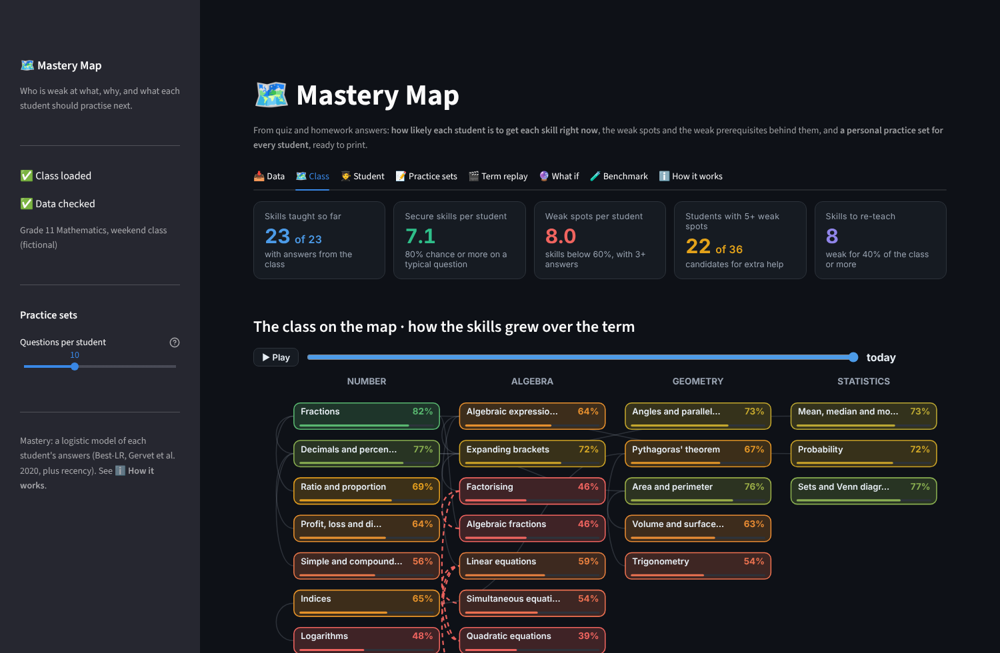

| **One student** | **Practice sets for everyone** |
|:---:|:---:|
| 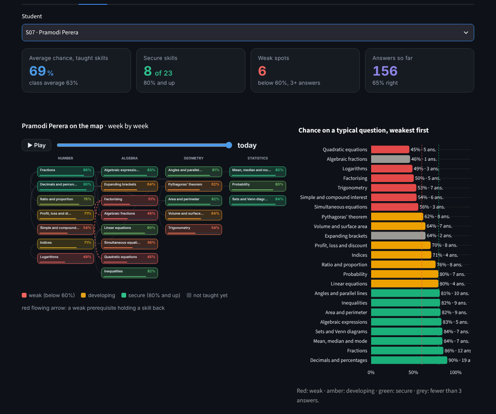 | 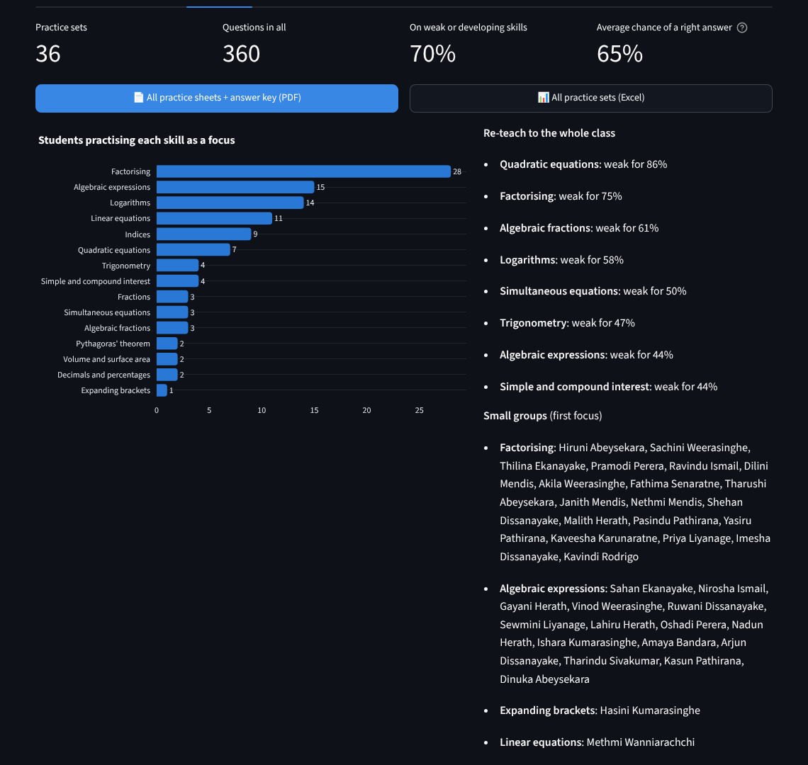 |
| **Every student, every skill** | **What if: two ways of practising** |
| 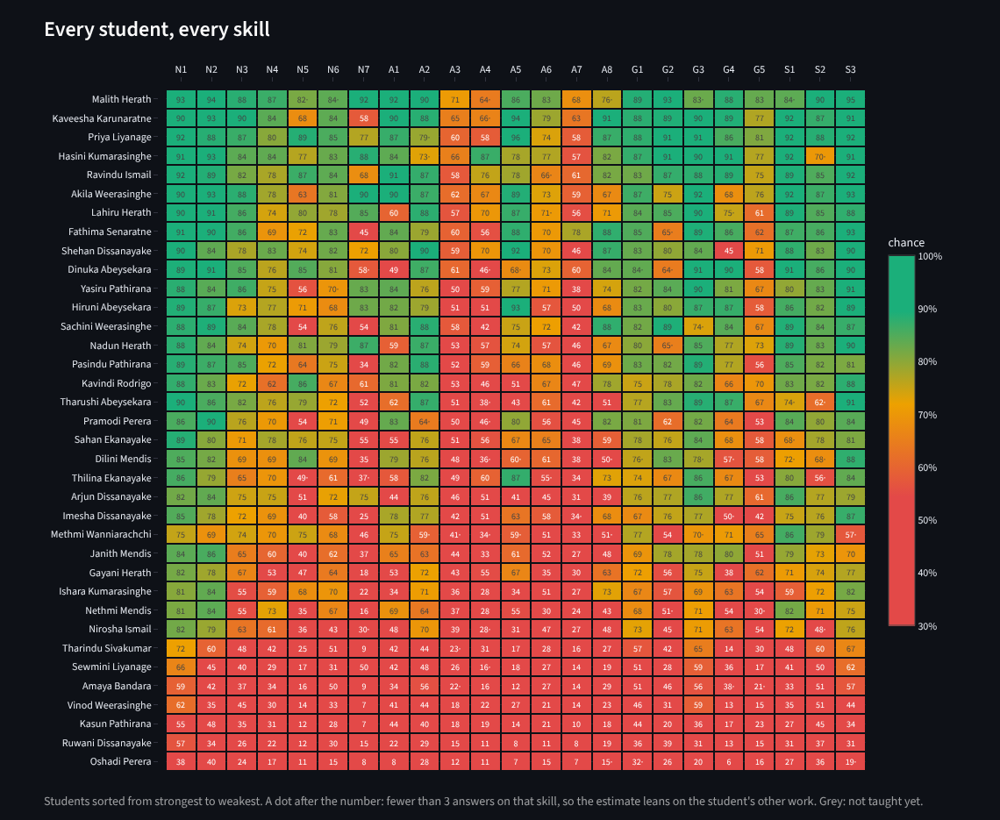 | 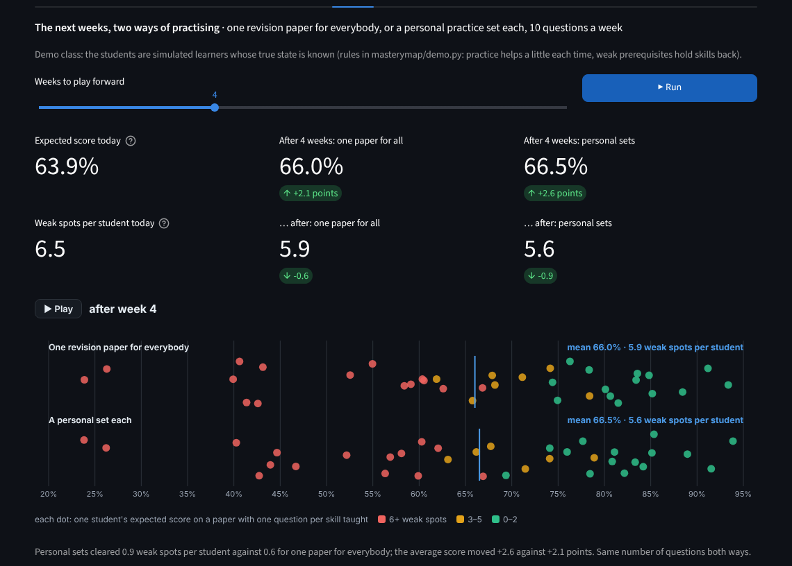 |
| **The data** | **The class on the map** |
| 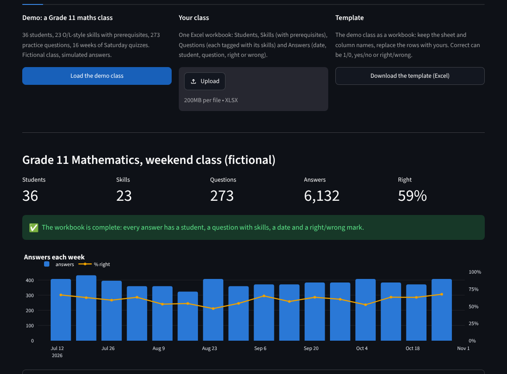 | 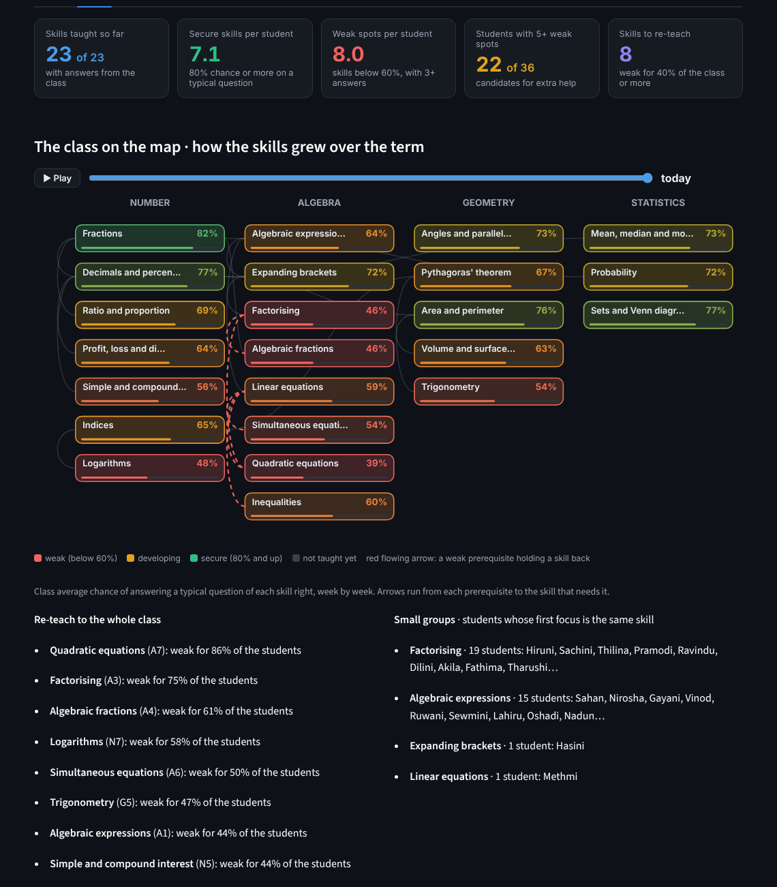 |

## 🎬 The term, week by week


Each Monday the model is fitted again on the answers given **before** that day only, so the replay shows what the
app would have said then. In the demo class (fictional, simulated answers), where the true state of every student is
known: the estimates correlate 0.84 with the true chances (marks per skill: 0.78); of the weak spots it flags, **76% are real** (marks per skill: 62%); it finds 72% of the real ones, where marks per skill find 78% but with many more false alarms. Playing four weeks forward, personal practice sets cleared **0.9 weak spots per student** against 0.6 for one revision paper for everybody, with the same number of questions; the average expected score rose about the same both ways (+2.6 and +2.1 points).

## 🧪 Benchmark: predicting the next answer


Six public datasets published with Gervet, Koedinger, Schneider & Mitchell (2020), *When is deep learning the best
approach to knowledge tracing?* (Journal of Educational Data Mining): the same preprocessed files, 5-fold
cross-validation by learner (a learner's answers are never seen while learning) and AUC per fold. Their best simple
model, Best-LR, is re-implemented here and gives their scores to within 0.005; Mastery Map adds recency and pooled
practice, chosen on ASSISTments 2009 only.

| Dataset | Answers | Marks per skill | DKT (published) | Best-LR (published) | Best-LR (here) | **Mastery Map** |
|---|---:|---:|---:|---:|---:|---:|
| ASSISTments 2009-10 (middle-school maths) | 278,336 | 0.696 | 0.757 | 0.772 | 0.772 | **0.780** ± 0.007 ✓ |
| Statics 2011 (engineering) | 189,297 | 0.631 | 0.829 | 0.819 | 0.819 | **0.827** ± 0.003 |
| Spanish vocabulary | 578,726 | 0.814 | 0.832 | 0.863 | 0.859 | **0.866** ± 0.008 ✓ |
| ASSISTments 2015 (maths) | 656,154 | 0.662 | 0.731 | 0.702 | 0.702 | **0.713** ± 0.002 |
| Algebra I 2005-06 (KDD Cup) | 606,983 | 0.747 | 0.821 | 0.831 | 0.827 | **0.837** ± 0.005 ✓ |
| ASSISTments 2017 (maths) | 934,638 | 0.610 | 0.770 | 0.714 | 0.713 | **0.720** ± 0.002 |

Mastery Map is above the published Best-LR on 6 of 6 datasets and above every model in the paper's table (✓) on 3; on Statics 2011 (best published: DKT 0.829), ASSISTments 2015 (best published: DKT 0.731), ASSISTments 2017 (best published: DKT 0.770) deep learning (DKT) stays ahead. Marks per skill, the mark-book view, is far behind everywhere. The predicted chances are calibrated: of the ASSISTments 2009 answers predicted between 60% and 80% (where practice questions are picked), 70.3% were right (predicted 70.8%).

## 🧠 How it works


| Step | In plain words |
|---|---|
| **Mastery** | A logistic model predicts each answer from the answers before it: how easy the question and its skills are, how many questions of each skill the student has tried and got right, recent answers counting more. A student's mastery of a skill is the predicted chance on a typical question of it, now. |
| **Weak spots** | Secure from 80%, developing from 60%, weak below; fewer than 3 answers is marked, since the estimate then leans on the student's other work. |
| **Practice set** | About 70% on the weakest skills whose prerequisites are in place (a weak prerequisite first), one check of a skill with too few answers, the rest review. Within a skill: questions not done yet, with a predicted chance near 70%. |
| **Questions** | Your question bank from the workbook; the demo has 273 generated O/L-style questions with answers over 23 skills. |
| **Replay** | The model refitted each Monday on earlier answers; nothing from later weeks. |

## 🚀 Quick start

```bash
git clone https://github.com/harshadulshan/mastery-map.git
cd mastery-map
pip install -r requirements.txt
streamlit run app.py
```

Click **Load the demo class**. For your own class, fill in
[`sample_data/class_template.xlsx`](sample_data/class_template.xlsx) (the fictional demo class): Students, Skills
(with prerequisites), Questions (each with its skill IDs) and Answers (date, student, question, right or wrong).

## ✅ Verified

```bash
python tests/verify_engine.py       # 28 checks: no look-ahead, Best-LR reproduced, practice sets, replay, sheets
python tests/verify_app.py          # 19 checks: clicks through every tab with the demo class
python tests/mutation_test.py       # 18 planted bugs, each must be caught
python benchmarks/run_kt.py         # the benchmark (data downloaded on first use, checked by SHA-256)
```

- **No look-ahead:** an answer's features come only from earlier answers; the app's prediction equals the trained
  model's to 1e-9; a replay with other answers from some week on gives the same estimates for every earlier week.
- **Published model reproduced:** Best-LR on Statics within 0.005 of the published AUC.
- **Practice sets:** taught skills only; about 70% on skills not yet secure; never a skill before its weak
  prerequisite; the first question of a skill is the unseen one nearest to 70%.
- **Mutation test:** 18 bugs planted one at a time (features that see the answer they predict, a replay that
  looks ahead, sets that ignore prerequisites, a wrong answer in the question bank, sheets that run together, ...).
  All caught.

## ⚠️ Limitations

- Right or wrong only: partial marks and which wrong answer was chosen are not used.
- Skills and prerequisites come from your workbook; a question tagged with the wrong skill misleads the estimate.
- What if uses simulated students: on the demo, learning rules written for it; on your class, the model itself.
  Its numbers show a direction, not a promise.
- The demo class is simulated, so its results show the method working when students behave as its rules say; the
  benchmark is the test on real learners.

Data: ASSISTments (Heffernan & Heffernan), Statics 2011 and the KDD Cup 2010 Algebra I set (PSLC DataShop), and the
Spanish vocabulary set (Lindsey et al.), as preprocessed and published by Gervet et al. (2020); downloaded on first
use from a pinned commit and checked by SHA-256, not included here. The demo class, its students and its answers are
fictional. Fonts: DejaVu Sans for the printable sheets (licence in `masterymap/fonts`).
